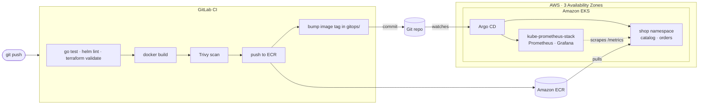

# KubeMicro

**Resilient microservices on Amazon EKS** — a reference platform provisioned end to end with Terraform, delivered with GitOps (Argo CD) and observed with Prometheus + Grafana.

[](https://github.com/oscarmajai/KubeMicro/actions/workflows/validate.yml)



CI never talks to the cluster: it publishes an immutable image and commits the new tag. Argo CD notices the commit and converges the cluster to whatever Git says.

## What's inside

| Path | What it is |
|---|---|
| `infra/terraform/` | VPC across 3 AZs (private nodes, NAT per AZ), EKS 1.36 with a managed node group, ECR repos, an IAM role GitLab CI assumes via OIDC, and the Argo CD bootstrap |
| `services/` | Two Go services: `catalog` and `orders` (orders prices every order against catalog) |
| `charts/microservice/` | One Helm chart shared by every service, with the resilience defaults built in |
| `gitops/apps/` | Argo CD Applications (app-of-apps): the services, kube-prometheus-stack, metrics-server and the Grafana dashboard |
| `gitops/values/` | Per-service values; CI rewrites the image tag here on every merge to `main` |
| `.gitlab-ci.yml` | The delivery pipeline: validate → build → scan → publish → deploy |
| `.github/workflows/validate.yml` | Validation for this GitHub copy (tests, Terraform, Helm, Trivy config scan) |

## Resilience, concretely

What keeps the services up when a pod, a node or a whole zone goes away:

- **Spread across zones, then nodes.** `topologySpreadConstraints` on `topology.kubernetes.io/zone` and `kubernetes.io/hostname`; the HPA never goes below 3 replicas, so each AZ runs one while all zones are healthy.
- **Disruptions are budgeted.** A `PodDisruptionBudget` (`maxUnavailable: 1`) and node group updates with `max_unavailable = 1`, so drains and upgrades take pods down one at a time.
- **Rollouts never lose capacity.** `maxUnavailable: 0`, `maxSurge: 1`.
- **Graceful shutdown.** On `SIGTERM` the service flips `/readyz` to 503, the `preStop` sleep gives the endpoints time to update, and in-flight requests get up to 20 s to finish.
- **Startup, liveness and readiness probes** on separate endpoints, so a slow start is never mistaken for a hang.
- **Calls between services are bounded.** `orders` calls `catalog` with an 800 ms timeout and up to 3 attempts with exponential backoff, retrying only on transient failures. A 404 is never retried. Each case is covered by a test.
- **No single NAT gateway.** One per AZ by default, so losing a zone doesn't cut egress for the others (`single_nat_gateway = true` trades this for ~$65/month).

## Security

- **No long-lived AWS keys in CI.** GitLab CI exchanges its OIDC ID token for a 1-hour session. The role trusts only pipelines on `main` of one project and can only push to the two ECR repos.
- **Immutable images.** ECR tags are immutable and set to the commit SHA, so a tag always means the same image. Scan on push is enabled.
- **Locked-down containers.** Distroless static base (~12 MB, no shell), non-root UID 65532, read-only root filesystem, all capabilities dropped, `RuntimeDefault` seccomp, no service account token mounted.
- **Pipeline gate.** Trivy fails the pipeline on any fixable HIGH/CRITICAL CVE in the images and on HIGH/CRITICAL misconfigurations in the Terraform, Helm chart, manifests and Dockerfile.
- **Accepted risks are written down.** [`.trivyignore`](.trivyignore) lists the two exceptions and why. The EKS API is public but restricted to `admin_cidrs`, and Terraform rejects `0.0.0.0/0`. Nodes have open egress to pull images and charts.
- **No secrets in Git.** Grafana's admin password is generated by Terraform straight into a Kubernetes secret. Argo CD and Grafana are reachable only through `kubectl port-forward`.

## Observability

kube-prometheus-stack scrapes every pod's `/metrics` through a `ServiceMonitor` that the chart creates. Each service exports `http_requests_total` and `http_request_duration_seconds`, labelled by route pattern (`GET /products/{id}`, not the raw path) to keep cardinality bounded.

The **KubeMicro · Overview** dashboard ([`gitops/platform/kubemicro-dashboard.yaml`](gitops/platform/kubemicro-dashboard.yaml)) is provisioned from Git. It shows:
- CPU and memory per pod
- Requests per second by status code
- p95 latency
- 5xx error rate
- Available replicas

## Deploy it

Requirements: Terraform ≥ 1.10, AWS CLI v2, kubectl, an S3 bucket for state, and a GitLab project.

```bash
cd infra/terraform
cp backend.hcl.example backend.hcl            # your state bucket
cp terraform.tfvars.example terraform.tfvars  # your IP and GitLab project
terraform init -backend-config=backend.hcl
terraform apply                                # ~15 min

$(terraform output -raw configure_kubectl)
kubectl -n argocd get applications            # Argo CD takes over from here
```

Then, in GitLab, go to **Settings → CI/CD → Variables** and set the CI variables listed at the top of [`.gitlab-ci.yml`](.gitlab-ci.yml). `AWS_ROLE_ARN` and `ECR_REGISTRY` come from `terraform output`. The first pipeline on `main` replaces the placeholder images in `gitops/values/`.

Look around:

```bash
kubectl -n argocd port-forward svc/argocd-server 8080:443         # Argo CD   → https://localhost:8080
kubectl -n monitoring port-forward svc/kube-prometheus-stack-grafana 3000:80   # Grafana → http://localhost:3000
terraform output -raw grafana_admin_password
```

Tear it down when you're done:

```bash
terraform destroy
```

## Cost

The cluster isn't running right now. Idle, the default HA setup costs roughly **$0.36/hour (~$260/month)** at us-east-1 on-demand list prices:

| Item | Cost |
|---|---|
| EKS control plane | $0.10/h |
| 3 NAT gateways | 3 × $0.045/h |
| 3 × t3.medium nodes | 3 × $0.0416/h |

That's before data transfer, EBS volumes and load balancers. A one-afternoon demo costs a couple of dollars. Check the [AWS Pricing Calculator](https://calculator.aws/) for your own region.

## Run the checks locally

```bash
cd services && go test -race ./...                                     # unit tests
docker build --build-arg SERVICE=orders -t orders services/            # image
cd infra/terraform && terraform init -backend=false && terraform validate
helm lint --strict charts/microservice -f gitops/values/orders.yaml
```

## License

[MIT](LICENSE) · Oscar Magaña Jaime · [oscarmajai.dev](https://oscarmajai.dev)
